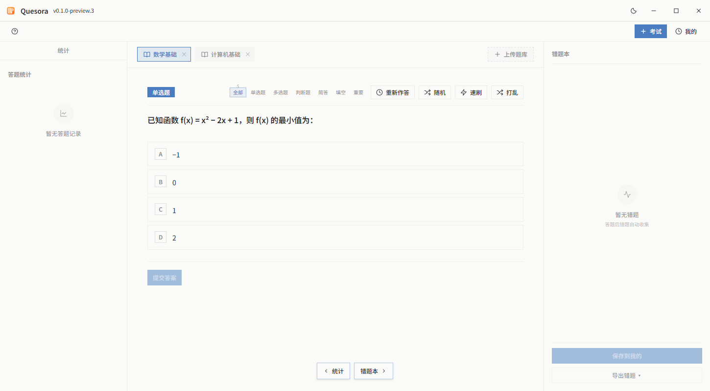

# Quesora Native

[](https://github.com/ispacewang/quesora-native/actions/workflows/windows.yml)
[](https://github.com/ispacewang/quesora-native/releases)

[](LICENSE)

Quesora 的 Go + [MyGo](https://github.com/egoist/mygo) 原生 Windows 实现。目标是保留 [Electron 版 Quesora](https://github.com/ispacewang/quesora) 的刷题、考试体验，减少运行时内存和分发体积。成品不依赖 Electron、Node.js、WebView 或 Python。

**当前为预览版，功能和视觉的完整 1:1 还原仍在进行中。** 优先支持离线题库导入、日常刷题和计时考试。



## 与 Electron 版对比

| 项目 | Electron 版 | Native 版 |
| --- | --- | --- |
| 界面与运行时 | Electron + Vue 3，网页组件 | Go + MyGo，原生绘制，无浏览器运行时 |
| 内存观察 | 约 160 MB | 约 30 MB |
| Windows x64 成品 | NSIS 安装包，尚未与本版统一测量体积 | EXE 约 28.54 MiB；便携 ZIP 约 16.25 MiB |
| 基本刷题 | 五种题型、筛选、随机、速刷、错题本 | 已实现，并支持重新作答开关、选项打乱、滚轮浏览多题库标签 |
| Excel / CSV | 支持导入 | 支持 XLSX / XLS / CSV；识别表头说明、多工作表、分列选项和答案含义；按内容识别 Excel 格式 |
| 考试与记录 | 自定义组卷、计时、成绩和历史 | 已实现；支持疑题标记、到期交卷、重要题规则、成绩与错题本保存 |
| 外观 | 原版三栏界面、深色模式 | 延续配色和布局，Mica 顶栏、磨砂悬浮按钮、重要题动画；细节仍在还原 |
| 公式、几何 | KaTeX / JSXGraph | 通用 LaTeX 和交互几何尚未完整移植，不能视为等价替代 |
| PDF 试卷 | 网页排版与 PDF 导出 | 原生中文 PDF、分页和答案导出；复杂公式和图形排版尚未还原 |
| AI 生成 / AI 判题 | 已提供 | 尚未移植，界面已隐藏 AI 入口；简答使用本地要点匹配 |
| 自动更新 | 已提供 | 尚未接入客户端自动更新；GitHub Actions 自动构建发布供手动下载 |
| 数据 | Electron 本地数据 | 独立 SQLite 数据目录，暂不自动迁移 Electron 数据 |

内存数字来自作者在同一台电脑上的手工观察，约减少 81%；没有统一统计进程集合、工作集口径、题库规模或运行时长，不是标准性能基准。体积为当前原生预览构建的近似值，内置中文字体与资源；后续功能会影响结果。

## 下载与使用

在 [Releases](https://github.com/ispacewang/quesora-native/releases) 下载 Windows x64 便携 ZIP，解压到可写目录后运行 `QuesoraNativePreview.exe`；也可使用独立 EXE。包含 `preview` 的版本属于预发布。

支持 Windows 10/11 x64。Mica 的实际效果取决于 Windows 版本和透明效果设置，不支持时使用普通主题背景。程序未进行代码签名。

点击「上传题库」选择 `.xlsx`、`.xls` 或 `.csv`。支持单选、多选、判断、填空、简答；无法确定的数据会提示来源行。文件最大 64 MiB，每个工作表最多十万行。程序不会修改上传的原文件。

数据保存到程序旁的 `data/questions.db`，或通过 `-data-dir` 指定；备份和升级时保留该目录。完整操作及格式说明见 [使用说明](docs/usage.md)。

## 从源码构建

使用 Windows x64、`go.mod` 指定版本的 Go，以及 Python 3.10+。无需额外安装 Python 包。

```powershell
git clone https://github.com/ispacewang/quesora-native.git
cd quesora-native
python build-preview.py
```

脚本在临时目录检查格式、校验依赖、运行 Go 测试和 MyGo 静态检查，构建带图标与高 DPI 清单的 EXE，生成离屏界面截图、带许可证的便携 ZIP 和 SHA-256 校验文件。常用预览文件在 `build/`，版本化发布文件在 `build/release/`。

## 自动检查与发布

- 推送 `main` 或提交 Pull Request：在 Windows runner 自动检查、测试、构建并上传 Actions 产物。
- 推送 `v*` 版本标签：完成相同检查后自动创建 GitHub Release，附带 EXE、ZIP 和校验文件。含连字符的预览版本自动标记为 prerelease。
- Actions 页面可手动运行检查和打包。Release 使用仓库自带的 `GITHUB_TOKEN`，无需在源码中配置个人 Token。

例如：

```powershell
git tag -a v0.1.0-preview.4 -m "Native preview 4"
git push origin v0.1.0-preview.4
```

标签版本会注入程序顶栏和产物文件名；构建脚本会校验版本格式。不要覆盖已经发布的标签。

## 目录与许可证

核心源码在根目录；`resources/` 包含图标、字体与公开示例题，`testdata/` 包含 XLS 测试样本，`third_party/xls/` 是保留来源与修改说明的兼容副本，`qa/` 是发布检查工具。数据库、个人题库、构建产物、缓存、IDE 配置和备份不提交到仓库。

项目沿用原 Quesora 仓库的 [Apache-2.0 许可证](LICENSE)。第三方组件和字体使用各自许可证，见 [NOTICE](NOTICE)、`third_party/` 和 `resources/fonts/`；发布 ZIP 附带依赖许可证。
