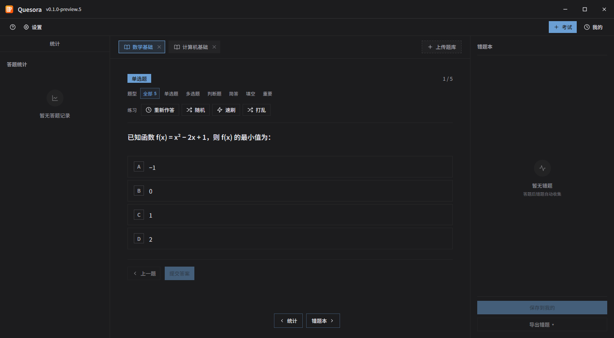
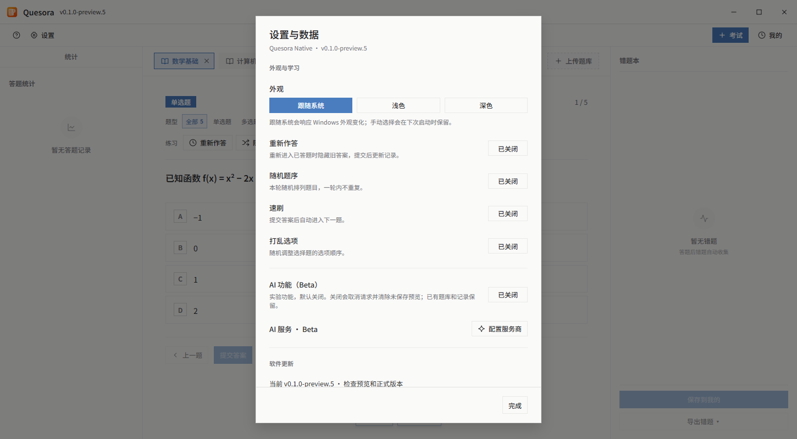
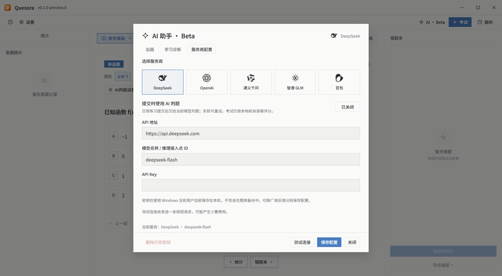
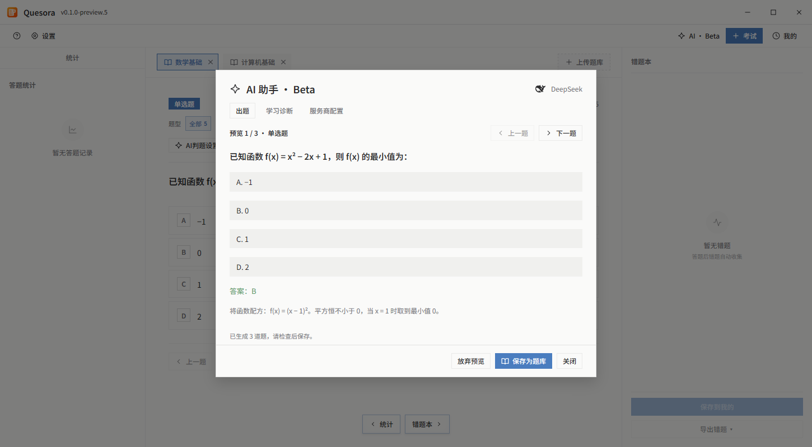
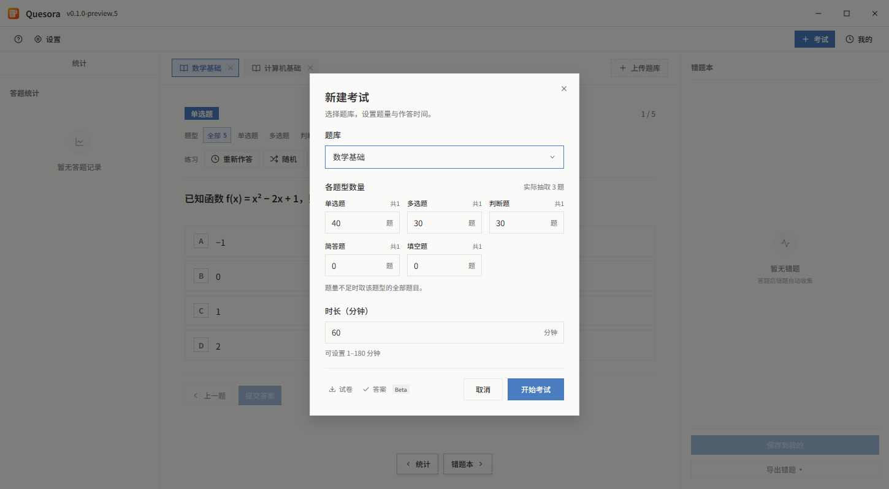
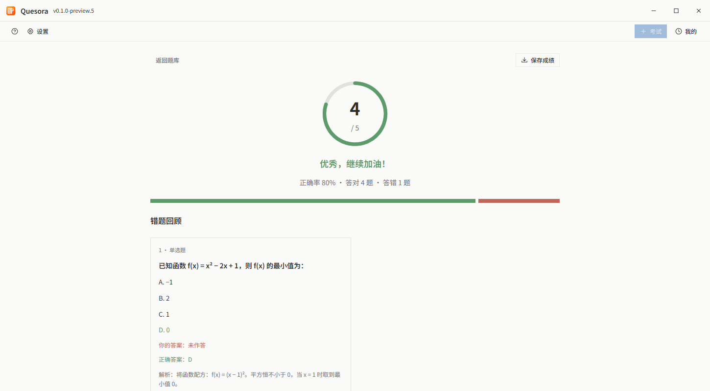

# Quesora Native

[](https://github.com/ispacewang/quesora-native/actions/workflows/windows.yml)
[](https://github.com/ispacewang/quesora-native/releases)
[](https://awesomemygo.dev/apps/quesora-native)

[](LICENSE)

Quesora 的 Go + [MyGo](https://github.com/egoist/mygo) 原生 Windows 版本。围绕刷题、题库、考试和可选 AI 助手，保留熟悉的三栏布局，减少内存和分发体积。运行不依赖 Electron、Node.js、WebView 或 Python。

**当前为预览版。AI 仍为 Beta，默认关闭，可在设置中显式开启或关闭。**

## 与 Electron 版的体积和内存对比

以下体积以本地 Electron **2.6.6** 成品与 Native **0.1.0-preview.5 / MyGo 0.7.4** 本轮构建为基线（2026-11-06，Windows x64）。MiB = 1024 × 1024 字节。

| 项目 | Electron 2.6.6 | Native preview.5 |
| --- | ---: | ---: |
| 主程序 EXE | **193.33 MiB** | **30.94 MiB** |
| Windows 安装包 | **204.57 MiB** | **17.12 MiB** |
| 便携 ZIP | 未单独提供 | **17.22 MiB** |
| 解包分发目录 | **468.03 MiB** | **31.13 MiB** |
| 日常内存观察 | **约 160 MB** | **约 30 MB** |
| 运行结构 | Chromium + Node.js，多进程 | Go + MyGo 原生绘制 |

主 EXE 体积约减少 84%；内存观察值约减少 81%。Electron 的 EXE 仍需随分发目录运行，Native EXE 自包含；这两行不是完整安装占用的同一口径。安装器另含安装/卸载程序，磁盘安装占用也不同于 ZIP 解包体积。

体积取自本轮 CI #14 成品；后续文档或构建更新可能有小幅变化，记录见 [构建对比数据](resources/build-comparison.json)。内存值是作者此前在同一台电脑上的手工观察，未统一进程集合、工作集、题量和运行时长；不是标准基准，也不是本轮 MyGo/AI 的峰值内存保证。原生版尚未完整覆盖 Electron 的通用公式、几何和复杂 PDF 排版，功能差异应一起考虑。

## 本轮新增与当前功能

| 功能 | 原生版当前状态 |
| --- | --- |
| 日常刷题 | 单选、多选、判断、填空、简答；重新作答、随机题序、速刷、选项打乱、重要题、统计和错题本 |
| 题库导入 | XLSX / XLS / CSV，按实际容器识别 Excel，理解表头和顶部说明，多工作表拆分题库；多题库标签支持鼠标滚轮横移 |
| 考试 | 自定义题型/题量、计时、疑题标记、自动交卷、重要题规则、历史成绩和中文 PDF 导出 |
| 外观 | **跟随系统 / 浅色 / 深色**；跟随模式响应 Windows 变化；Mica 顶栏；移除顶栏主题切换按钮 |
| AI 助手（Beta） | **默认关闭**；DeepSeek、OpenAI、通义千问、智谱 GLM、豆包，品牌图标与独立密钥/模型配置 |
| AI 出题 | 主题或参考资料出题，完整预览后确认入库；TXT/MD/CSV/Excel/DOCX/文本 PDF 在本地解析 |
| AI 判题与诊断 | 可选提交时 AI 判题、单题复核后显式应用、薄弱点诊断；考试仍使用本地评分 |
| 数据与更新 | SQLite 自动保存、设置备份/恢复、官方发布检查、下载安装包、SHA-256 校验与确认升级 |
| 安装升级 | 记住自定义路径、覆盖程序、同版本重装、拒绝降级、升级/卸载保留用户数据 |
| 当前迁移边界 | 通用 LaTeX、交互几何、复杂公式/图形 PDF、跨重启续考及导入前手动列映射仍待完善 |

AI 为实验功能，关闭时取消请求并隐藏入口，已有题库和记录保留。用户自行配置服务商 Key，使用 Windows 当前用户加密保存；发送前可查看资料，生成结果不会直接入库。完整配置、资料限制、计费和验收边界见 [AI 使用说明](docs/ai.md)。

MyGo 已升级至 [v0.7.4](https://github.com/egoist/mygo/releases/tag/v0.7.4)，使用 Windows 首帧显示、窗口边缘及高缩放修复；重要题动画响应减少动态效果。Excelize 已升级 v2.11.1，修复可达的 Excel 解析漏洞。

## 当前界面截图

截图均于 2026-11-06 从当前源码的离屏示例场景重新生成，不包含个人题库或密钥。Windows 上实际 Mica 效果由系统和透明设置决定，离屏图不代表原生窗口验收。

### 刷题与深浅外观




### 外观设置与 AI Beta 总开关



### AI 服务商配置与出题预览




### 考试




## 下载与使用

在 [Releases](https://github.com/ispacewang/quesora-native/releases) 下载 Windows x64 安装包（`*-setup-windows-x64.exe`，从 preview.4 开始提供），或下载便携 ZIP 解压运行 `QuesoraNativePreview.exe`。包含 `preview` 的版本属于预发布。

安装包为当前用户安装，无需管理员权限。首次可选择安装位置；再次安装会沿用原路径并覆盖程序文件，保留题库、答题记录和学习设置。同版本可重装，旧版本安装包会拒绝降级覆盖。

支持 Windows 10/11 x64。Mica 的实际效果取决于 Windows 版本和透明效果设置，不支持时使用普通主题背景。程序未进行代码签名。

点击「上传题库」选择 `.xlsx`、`.xls` 或 `.csv`。支持单选、多选、判断、填空、简答；无法确定的数据会提示来源行。文件最大 64 MiB，每个工作表最多十万行。程序不会修改上传的原文件。

安装版的数据在 `%LOCALAPPDATA%\QuesoraNative\data\questions.db`，卸载后仍保留。便携版仍使用程序旁的 `data/questions.db`，或通过 `-data-dir` 指定。若安装到旧便携版所在目录，首次启动会将该目录的旧数据库一致性快照迁移到用户数据目录，保留原文件；目标已有数据库时不会覆盖。其他便携目录不会自动扫描。

顶部「设置」可选择跟随系统/浅色/深色外观、开关 AI Beta、切换学习偏好、打开数据目录、备份及恢复全部数据，并手动检查软件更新。主题、练习模式、筛选与当前题目会在重启后恢复。完整操作及格式说明见 [使用说明](docs/usage.md)。

## 从源码构建

使用 Windows x64、`go.mod` 指定版本的 Go，以及 Python 3.10+。无需额外安装 Python 包。

```powershell
git clone https://github.com/ispacewang/quesora-native.git
cd quesora-native
python build-preview.py
```

脚本在临时目录检查格式、校验依赖、运行 Go 测试和 MyGo 静态检查，构建带图标与高 DPI 清单的 EXE，生成离屏界面截图、带许可证的便携 ZIP 和 SHA-256 校验文件。常用预览文件在 `build/`，版本化发布文件在 `build/release/`。额外安装 Inno Setup 6.7.1+ 后，运行 `python build-preview.py --installer` 可同时生成安装包；也可用 `--iscc` 指定编译器路径。

## 自动检查与发布

- 推送 `main` 或提交 Pull Request：在 Windows runner 自动检查、测试、构建并上传 Actions 产物。
- 推送 `v*` 版本标签：完成相同检查后自动创建 GitHub Release，附带安装包、EXE、ZIP 和校验文件。含连字符的预览版本自动标记为 prerelease。
- 发布前在临时 Windows runner 验证自定义目录安装、不指定路径升级、EXE 覆盖、同版本重装、降级拦截和卸载保留数据。
- Actions 页面可手动运行检查和打包。Release 使用仓库自带的 `GITHUB_TOKEN`，无需在源码中配置个人 Token。

例如：

```powershell
git tag -a v0.1.0-preview.4 -m "Native preview 4"
git push origin v0.1.0-preview.4
```

标签版本会注入程序顶栏和产物文件名；构建脚本会校验版本格式。不要覆盖已经发布的标签。

## 目录与许可证

核心源码在根目录；`resources/` 包含图标、字体与公开示例题，`testdata/` 包含 XLS 测试样本，`third_party/xls/` 是保留来源与修改说明的兼容副本，`qa/` 是发布检查工具。数据库、个人题库、构建产物、缓存、IDE 配置和备份不提交到仓库。

项目沿用原 Quesora 仓库的 [Apache-2.0 许可证](LICENSE)。第三方组件和字体使用各自许可证，见 [NOTICE](NOTICE)、`third_party/` 和 `resources/fonts/`；发布 ZIP 附带依赖许可证。

维护者可从 [开发导览](docs/development.md) 和根包 doc.go 了解模块职责、线程边界、解析扩展、数据保护及验证流程。
